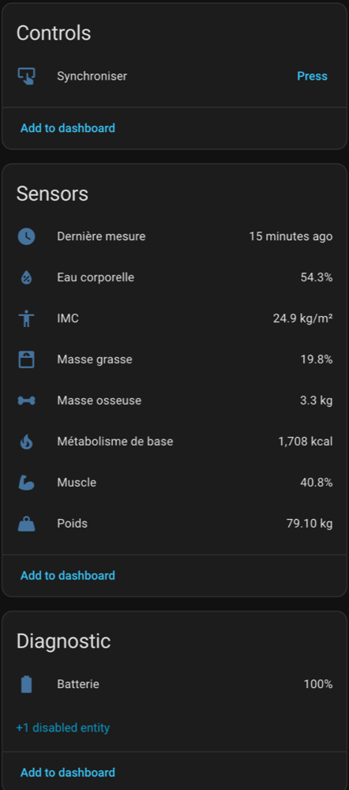

# Sanitas SBF73 for Home Assistant

Home Assistant integration for the Sanitas SBF73 body composition scale, over Bluetooth LE.
No cloud, no phone app.

The protocol was reverse engineered from the Sanitas HealthCoach Android app (v3.0.1) with
[REA](https://github.com/morluto/rea) and JADX, and cross-checked with
[openScale](https://github.com/oliexdev/openScale). Details in [docs/PROTOCOL.md](docs/PROTOCOL.md).

## What you get



- Weight, BMI, body fat, body water, muscle, bone mass, basal metabolism, impedance (disabled by default)
- Battery level and the time of the last measurement
- A Sync button

## Install

Add this repository to HACS as a custom repository, or copy `custom_components/sanitas_sbf73`
into your `config/custom_components` folder. Restart Home Assistant.

The Home Assistant host needs its own Bluetooth adapter: pairing goes through a BlueZ agent, so
setup does not work through ESPHome Bluetooth proxies.

## Setup

1. The scale shows up as discovered in Settings > Devices & services.
2. Step on the scale briefly to wake it up, then submit. Home Assistant pairs with it. If the scale
   shows a code, type it.
3. Pick your user on the scale (it then shows a 4-digit PIN to type), or create a new one. A new
   user needs a first weighing so the scale learns to recognize them.

## How syncing works

Idle, the scale advertises all the time with an empty Weight Scale service data, and refuses
GATT writes. When you step on it, it advertises every 200 ms and the service data becomes
`01`. The integration connects at that moment, sends the PIN consent and receives the
measurement. The Sync button does the same on demand, while the scale is awake.

After each session the integration calls BlueZ `Device1.Disconnect` itself. Without it, BlueZ
keeps auto-connecting the bonded scale every time it wakes up, and the scale stops advertising.

## Tests

```bash
python3 -m unittest discover tests
```
